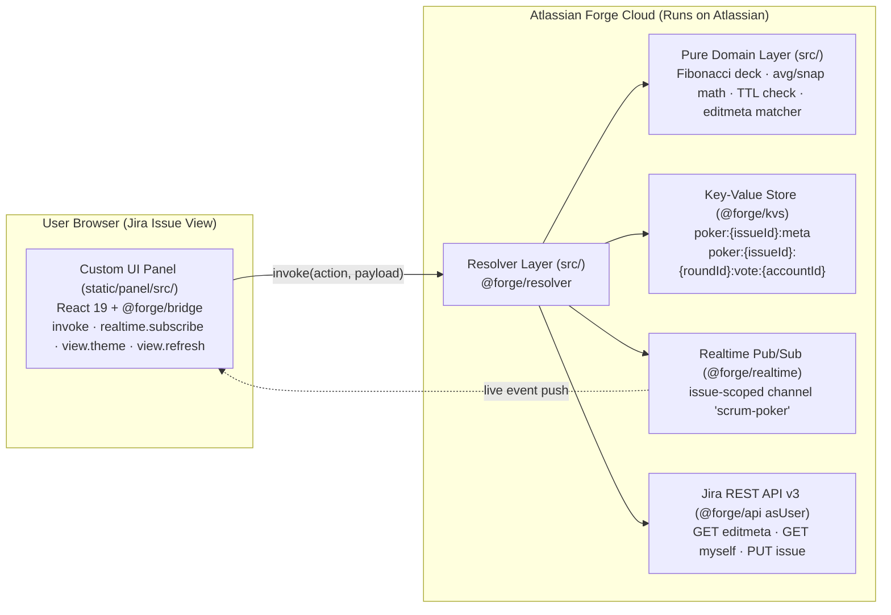

# Architecture

How the Scrum Poker Forge app is layered across Jira Cloud's Custom UI iframe and Forge's Node.js 22 runtime. Product rules live in [product.md](product.md), feature specifications in [../specs/index.md](../specs/index.md), and decision history in [decisions.md](decisions.md).

## Layers

- **Presentation (`static/panel/src/`):** React 19 Custom UI single-page bundle built with Vite (`base: './'`) into `static/panel/build/`. Syncs Jira Light/Dark mode via `view.theme.enable()`, invokes backend resolvers via `invoke()`, subscribes to live issue-scoped updates via `realtime.subscribe()`, refreshes the parent issue view via `view.refresh()`, and handles clipboard fallback when Story Points is unavailable on the issue screen.
- **Domain (`src/` pure modules):** Stateless, framework-free TypeScript functions for deck validation (`0, 1, 2, 3, 5, 8, 13, 21, ?`), numeric average and nearest-Fibonacci snapping (ties round up), 24-hour timestamp expiration checks, view-model redaction (stripping unrevealed card values), and Jira `editmeta` Story Points field matching.
- **Data & Integration (`src/` Forge resolvers & adapters):** Thin `@forge/resolver` handlers orchestrating `@forge/kvs` storage, `@forge/realtime` event publishing, and `@forge/api` (`api.asUser().requestJira(...)`) calls against Jira Cloud REST API v3.

## Patterns

- **Per-Voter KVS Key Isolation ([D-09](decisions.md)):**
  - Round state lives in `poker:${issueId}:meta` (`{ roundId, revealed, updatedAt }`).
  - Each voter's pick lives in its own key `poker:${issueId}:${roundId}:vote:${accountId}` (`{ accountId, displayName, avatarUrl, card, votedAt }`), queried via `WhereConditions.beginsWith("poker:${issueId}:${roundId}:vote:")` with cursor pagination.
  - Concurrent card clicks by multiple teammates never write to the same key, eliminating read-modify-write lost updates. Resetting or clearing a round increments `roundId` (or resets `meta`) in O(1).
- **Dual 24-Hour Expiry ([D-08](decisions.md)):**
  - Every `kvs.set` sets `{ ttl: { value: 24, unit: 'HOURS' } }` so Forge reclaims storage automatically.
  - Because Forge KVS sweeps expired entries lazily (up to 48 hours), read paths also enforce `now - updatedAt <= 86_400_000` ms so stale rounds are immediately treated as empty.
- **Backend Vote Secrecy:**
  - While `revealed === false`, backend responses and `@forge/realtime` notifications omit other participants' `card` values completely; clients only learn *who* has voted (`accountId`, `displayName`, `avatarUrl`) plus the caller's own `myVote` returned directly from their `invoke` call.
- **Notification + Authoritative State Sync:**
  - Backend mutations (`castVote`, `withdrawVote`, `revealVotes`, `resetRound`, `applyStoryPoints`) persist to `@forge/kvs` first and then publish a lightweight `{ type: 'SESSION_UPDATED', roundId }` event on `@forge/realtime` so open client tabs re-fetch or apply consistent server-redacted state.

## Key Decisions

- **Forge Custom UI over UI Kit ([D-09](decisions.md)):** Forge UI Kit (`@forge/react`) blocks DOM clipboard access (`navigator.clipboard` / `execCommand`) needed for the missing-field **Copy Score** fallback ([D-07](decisions.md)) and restricts compact playing-card interactions.
- **Zero External Egress (`Runs on Atlassian`, [D-01](decisions.md)):** All compute and storage remain inside Atlassian Forge (`storage:app`, `read:jira-work`, `write:jira-work`, `read:jira-user`), enforced statically in `.lintel/scripts/build.sh`.
- **User-Attributed Jira Mutations ([D-07](decisions.md)):** Story Points updates always use `api.asUser()` rather than `api.asApp()`, respecting Jira project permissions and recording the person who applied the estimate in Jira's issue history.
