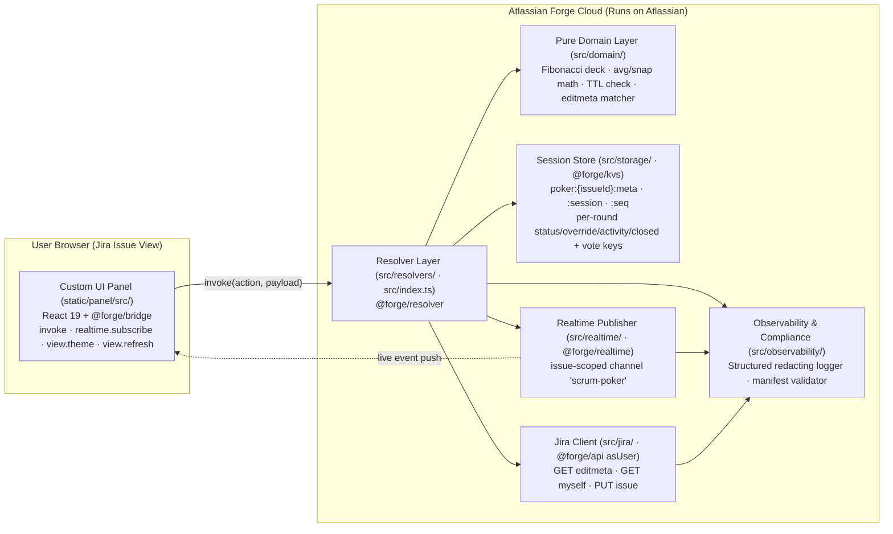

# Architecture

How the Scrum Poker Forge app is layered across Jira Cloud's Custom UI iframe and Forge's Node.js 22 runtime. Product rules live in [product.md](product.md), feature specifications in [../specs/index.md](../specs/index.md), and decision history in [decisions.md](decisions.md).

## Layers

- **Presentation (`static/panel/src/`):** React 19 Custom UI single-page bundle built with Vite (`base: './'`) into `static/panel/build/` and rendered in Jira's right-hand `jira:issueContext` sidebar ([D-11](decisions.md)). Enables Jira Light/Dark mode via `view.theme.enable()` prior to mounting, invokes backend resolvers (`getSession`, `castVote`, `withdrawVote`, `revealVotes`, `selectOverrideScore`, `resetRound`, `applyStoryPoints`) via a lazy-loaded `@forge/bridge` client (`bridge/poker-client.ts`), subscribes to live issue-scoped updates via `realtime.subscribe('scrum-poker', ...)` with foreground tab visibility resync, deduplicates parent issue refreshes (`view.refresh()`) across self/peer `'points-applied'` events, and executes two-tier clipboard copy (`navigator.clipboard.writeText` with off-screen `<textarea>` + `document.execCommand('copy')` fallback in `clipboard/copy-score.ts`) when Story Points is unavailable on the issue screen.
- **Domain (`src/domain/`):** Stateless, framework-free TypeScript modules for deck and numeric score validation (`types.ts`, `deck.ts`), unrounded numeric mean and nearest-Fibonacci snapping with upward midpoint tie-breaking plus half-up display formatting (`scoring.ts`), 24-hour expiration checks and caller-scoped session redaction/projection (`session-view.ts`), and Jira `editmeta` Story Points field matching (`jira-fields.ts`).
- **Data, Integration & Observability (`src/resolvers/`, `src/storage/`, `src/jira/`, `src/realtime/`, `src/observability/`, `src/index.ts`):** Thin `@forge/resolver` handlers (`poker-resolvers.ts`) extracting authenticated host context (`context.extension.issue.id`, `context.accountId`) before orchestrating `@forge/kvs` storage (`session-store.ts`), `@forge/realtime` event publishing (`publisher.ts`), `@forge/api` (`api.asUser().requestJira(...)`) Jira REST v3 calls (`jira-client.ts`), and JSON structured logging with automatic card/credential/PII redaction (`logger.ts`).

## Patterns

- **Per-Voter, Session-Epoched & Monotonic Per-Round KVS Key Isolation ([D-09](decisions.md), [D-10](decisions.md), [D-12](decisions.md)):**
  - Base round pointer lives in `poker:${issueId}:meta`, paired with session-epoch metadata `poker:${issueId}:session` (`24 HOURS` TTL), monotonic round/epoch sequence state `poker:${issueId}:seq` (`7 DAYS` TTL so round IDs never restart at `round-1` across lazy KVS sweeps), and monotonic per-round keys `poker:${issueId}:${roundId}:status` (write-once `'revealed'`), `poker:${issueId}:${roundId}:override`, `poker:${issueId}:${roundId}:activity`, and `poker:${issueId}:${roundId}:closed` (forward pointer written on reset/apply/expiry rollover).
  - Each voter's pick lives in its own key `poker:${issueId}:${roundId}:vote:${accountId}` (`{ accountId, displayName, avatarUrl, card, votedAt, sessionEpoch }`), queried via `WhereConditions.beginsWith("poker:${issueId}:${roundId}:vote:")` with `.limit(100)` and `nextCursor` loop pagination.
  - Per-round tombstones and voter records are scoped to the active `sessionEpoch`, every resolver mutation binds the observed `{ meta, sessionEpoch }` (`expectedEpoch` + `expectedRoundId`) onto subsequent KVS writes/deletes so delayed prior-session or stale same-session operations abort instead of crossing into a newer round or epoch, and both `initializeRound` and legacy/expired `advanceRound` rollovers sweep stale target-round keys — preventing lazy KVS TTL eviction or legacy upgrades from ever resurrecting prior rounds or votes even if a round identifier is reused.
  - Vote casts, updates, and withdrawals write the voter's key and `poker:${issueId}:${roundId}:activity` (reusing the voter's cached `displayName`/`avatarUrl` on active vote updates) and refresh `poker:${issueId}:meta` / `poker:${issueId}:session` 24-hour retention from the resolved monotonic state so active voting sessions never lose their anchor while an in-flight vote still cannot revert `status: 'revealed'`, clear `overrideScore`, or undo a concurrent `resetRound` / `applyStoryPoints`.
- **Dual 24-Hour Expiry ([D-08](decisions.md)):**
  - Every `kvs.set` passes `{ ttl: { value: 24, unit: 'HOURS' } }` so Forge reclaims storage automatically.
  - Because Forge KVS sweeps expired entries lazily (up to 48 hours), read and query paths inspect KVS `EXPIRE_TIME` metadata (`metadataFields: ['EXPIRE_TIME']`) and enforce `nowMs - updatedAt < 86_400_000` ms (`isRoundExpired` triggers at `>= 86_400_000` ms while tolerating minor negative clock skew) without extending `updatedAt` on expired reads.
- **Defense-in-Depth Vote Secrecy:**
  - While `status === 'voting'`, `projectSessionSnapshot` sets `card: null` (`hasVoted: true`) on every `ParticipantView`, exposing only the requesting caller's selection in `SessionSnapshot.viewerCard`.
  - `@forge/realtime` notifications carry only `{ type: 'SESSION_UPDATED', roundId, updatedAt }` or `{ type: 'points-applied', roundId, score, updatedAt }`; `parseRealtimeEvent` on the client rejects any payload containing vote/card keys, and `sanitizeLogMetadata` on the backend scrubs vote/card/credential/email fields to `'[REDACTED]'`.
- **Notification + Authoritative State Sync ([D-10](decisions.md)):**
  - Backend mutations persist to `@forge/kvs` first and then publish `'SESSION_UPDATED'` (or `'points-applied'` after a successful Jira `PUT`) on `'scrum-poker'` so open client tabs re-fetch their caller-scoped `getSession` snapshot (guarded by mutation epochs against out-of-order overwrites) and refresh the parent Jira issue view once per applied round.

## Key Decisions

- **Forge Custom UI over UI Kit ([D-09](decisions.md)):** Forge UI Kit (`@forge/react`) blocks DOM clipboard access (`navigator.clipboard` / `execCommand`) needed for the missing-field **Copy Score** fallback ([D-07](decisions.md)) and restricts compact playing-card interactions.
- **Zero External Egress (`Runs on Atlassian`, [D-01](decisions.md)):** All compute and storage remain inside Atlassian Forge (`storage:app`, `read:jira-work`, `write:jira-work`, `read:jira-user`), enforced statically in `.lintel/scripts/build.sh`.
- **User-Attributed Jira Mutations ([D-07](decisions.md)):** Story Points updates always use `api.asUser()` rather than `api.asApp()`, respecting Jira project permissions and recording the person who applied the estimate in Jira's issue history.
