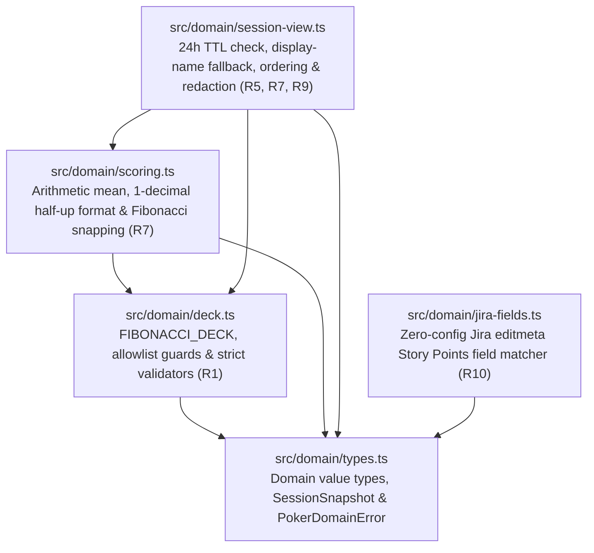

# Phase 1 Design: Scrum Poker Domain Rules, Fibonacci Scoring, Expiry, and Jira Field Matching

## Overview & Minimal-Seam Rationale

Phase 1 isolates all core Scrum Poker business logic inside a pure, stateless TypeScript domain layer under `src/domain/`. By keeping `src/domain/` completely free of `@forge/kvs`, `@forge/api`, `@forge/realtime`, `@forge/resolver`, `@forge/bridge`, React, and browser DOM globals:

1. **Single Authoritative Rulebook:** Deck membership (`R1`), numeric average and nearest-Fibonacci snapping (`R7`), 24-hour inactivity expiry (`R9`), vote-secrecy participant projection (`R5`), and Jira `editmeta` Story Points field detection (`R10`) live in one place rather than drifting between backend resolvers and Custom UI views.
2. **Minimal Seams:** Five focused modules expose plain immutable data types, typed domain errors (`PokerDomainError`), and pure deterministic functions with explicit clock injection (`nowMs: number`). Phase 2 Forge resolvers become thin orchestration adapters over `@forge/kvs`, `@forge/realtime`, and `@forge/api`, while Phase 3 Custom UI components import shared `SessionSnapshot` types via `import type` with zero Node-only runtime leakage.

---

## Module Responsibilities & Dependency Graph

Modules form a strict directed acyclic graph (DAG) with zero circular imports:

1. **`src/domain/types.ts`**
   - Defines canonical types (`NumericDeckCard`, `QuestionCard`, `DeckCard`, `FibonacciScore`, `RoundStatus`, `StoryPointsFieldInfo`, `RoundMeta`, `VoteRecord`, `ParticipantView`, `ScoreSummary`, `ProjectSessionParams`, `SessionSnapshot`) with `readonly` fields so projected view models cannot be mutated accidentally across callers.
   - Defines `PokerErrorCode` (`'validation-error' | 'invalid-state' | 'precondition-failed'`) and `PokerDomainError extends Error` (`name = 'PokerDomainError'`, `readonly code: PokerErrorCode`) so validation and state-transition rejections carry machine-checkable codes across domain and resolver boundaries.

2. **`src/domain/deck.ts` (`R1`)**
   - Exports `FIBONACCI_DECK` (`['0', '1', '2', '3', '5', '8', '13', '21', '?']`) and `NUMERIC_FIBONACCI_SCORES` (`[0, 1, 2, 3, 5, 8, 13, 21]`).
   - Provides narrow predicates (`isValidDeckCard`, `isNumericDeckCard`, `isValidFibonacciScore`), exact conversion (`cardToNumericScore`), and fail-closed boundary validators (`validateDeckCard`, `validateFibonacciScore`) that reject any non-allowlisted input—including whitespace-padded strings (`' 5 '`), empty strings, negative numbers, `-0`, decimals (`3.5`, `4.5`), non-Fibonacci integers (`4`, `6`, `22`, `34`, `100`), `NaN`, `Infinity`, `'?'` as a numeric target score, `null`, and `undefined`—by throwing `PokerDomainError` with `code: 'validation-error'`.

3. **`src/domain/scoring.ts` (`R7`)**
   - `calculateScoreSummary(cards)` validates each card in `cards`, filters out `'?'` while retaining `'0'` (`0`) in both sum and count, and returns `{ numericVoteCount: 0, average: null, formattedAverage: null, recommendedScore: null }` when zero numeric votes exist.
   - `snapToNearestFibonacci(mean)` compares the **exact unrounded** `mean` against `NUMERIC_FIBONACCI_SCORES` in ascending order, selecting the score with minimum `Math.abs(mean - candidate)` and breaking exact ties (`diff <= bestDiff`) upward so midpoints (`0.5 -> 1`, `1.5 -> 2`, `2.5 -> 3`, `4.0 -> 5`, `6.5 -> 8`, `10.5 -> 13`, `17.0 -> 21`) round up while values strictly below a midpoint (such as `6.49`) snap downward (`5`) even when `formatAverage(6.49)` formats as `"6.5"`.
   - `formatAverage(mean)` validates that `mean` is a non-negative finite number (rejecting `-0`, negative values, `NaN`, and `±Infinity` with `PokerDomainError` `code: 'validation-error'`) and rounds half-up to at most `1` fractional digit against `mean`'s canonical base-10 decimal representation (`Number.prototype.toString(10)`), omitting trailing `'.0'` when the rounded value is an integer and omitting grouping separators (`0 -> '0'`, `0.04 -> '0'`, `0.05 -> '0.1'`, `5 -> '5'`, `1.5 -> '1.5'`, `2.55 -> '2.6'`, `4.333... -> '4.3'`, `6.49 -> '6.5'`, `9.95 -> '10'`, `17.15 -> '17.2'`).

4. **`src/domain/session-view.ts` (`R5`, `R7`, `R9`)**
   - `isRoundExpired(updatedAt, nowMs)` enforces the exact 24-hour inactivity boundary (`SESSION_TTL_MS = 86_400_000`): returns `true` when `nowMs - updatedAt >= 86_400_000` and `false` when `nowMs - updatedAt < 86_400_000` (including `86_399_999` ms and negative deltas caused by minor clock skew where `nowMs < updatedAt`).
   - `normalizeDisplayName(displayName)` trims leading/trailing whitespace and substitutes `FALLBACK_DISPLAY_NAME` (`'Unknown User'`) whenever `displayName` is `null`, `undefined`, empty, or whitespace-only.
   - `createIdleSessionSnapshot(storyPointsField, roundId)` validates any non-null `roundId` against the strict canonical identifier predicate (`typeof s === 'string' && s.trim().length > 0 && s === s.trim()`) and builds a clean `'voting'` `SessionSnapshot` with `0` participants and `null` card/score fields.
   - `projectSessionSnapshot(params)` enforces the same strict canonical identifier predicate (`typeof s === 'string' && s.trim().length > 0 && s === s.trim()`, rejecting empty, whitespace-only, and leading/trailing whitespace-padded strings with `PokerDomainError` `code: 'validation-error'`) consistently across `params.viewerAccountId`, active `params.meta.roundId`, and every `vote.accountId`, validates finite timestamps, returns an idle `'voting'` snapshot whenever `meta === null` or `isRoundExpired(meta.updatedAt, nowMs)` is `true`, deduplicates any repeated `accountId` records defensively (keeping the record with the latest `votedAt`, or the later array element on tie), orders active voters by ascending `votedAt` then ascending UTF-16 code-unit `accountId` (`<` / `>`), populates `viewerCard` solely for `viewerAccountId` (`vote.accountId === params.viewerAccountId`), redacts all `participants[i].card` values to `null` while `meta.status === 'voting'`, and exposes `card` values plus `average`, `formattedAverage`, `recommendedScore`, and `targetScore` (`meta.overrideScore !== null ? meta.overrideScore : summary.recommendedScore`) while `meta.status === 'revealed'`.

5. **`src/domain/jira-fields.ts` (`R10`)**
   - `detectStoryPointsField(editMeta)` inspects arbitrary unknown JSON from Jira's `GET /rest/api/3/issue/{issueIdOrKey}/editmeta` endpoint without throwing on `null`, primitives, arrays, or missing/malformed properties.
   - Own enumerable entries of `editMeta.fields` (ignoring `__proto__`, `constructor`, `prototype`, and blank keys) qualify iff:
     1. `field.name` is a string whose `.trim().toLowerCase()` equals `'story points'` (tier `0`, canonical `fieldName: 'Story Points'`) or `'story point estimate'` (tier `1`, canonical `fieldName: 'Story point estimate'`).
     2. When `field.schema` is present (`!== undefined && !== null`), `field.schema` is a plain object and, if `field.schema.type` is present (`!== undefined && !== null`), `field.schema.type === 'number'`.
     3. When `field.operations` is present (`!== undefined && !== null`), `Array.isArray(field.operations)` is `true` and `field.operations.includes('set')`.
   - Qualifying candidates are ranked by ascending tier (`'Story Points'` ahead of `'Story point estimate'`), breaking ties within the same tier by ascending UTF-16 code-unit `fieldId` (`<` / `>`). Returns `{ fieldId, fieldName }` for the top candidate or `null` if none match.

---

## Security, Trust Boundaries & Operability

- **Trust Boundary Enforcement:** Phase 1 functions treat card inputs, target score inputs, `viewerAccountId`, timestamps, and external Jira `editmeta` payloads as untrusted boundary inputs. Card and score validators enforce strict exact allowlists with zero implicit string trimming or numeric coercion; `detectStoryPointsField` guards against prototype-pollution keys and malformed nested schemas.
- **Vote Secrecy by Construction (`R5`):** `projectSessionSnapshot` strips peer card selections at the projection layer while `status === 'voting'`, guaranteeing `participants[i].card === null` even for the requesting voter's own row while returning the caller's choice exclusively in `viewerCard`.
- **Deterministic Operability (`R5`, `R9`):** Clock evaluation is injected explicitly via `nowMs: number` rather than calling `Date.now()` inside domain projections, and tie-breaking uses locale-independent `<` / `>` string comparison rather than `localeCompare`. No logging occurs inside pure domain helpers, preventing accidental emission of unrevealed card values (`R14`).

---

## Edge Cases Handled

- **`-0` vs `0`:** `Object.is(value, -0)` is rejected as an invalid `FibonacciScore` (`validation-error`), while positive/unsigned `0` and `'0'` are valid numeric votes (`(0 + 2) / 2 = 1`) and valid post-reveal override targets (`0 !== null`).
- **Unrounded Snapping vs Rounded Display (`R7`):** A mean of `6.49` (e.g., `649 / 100`) snaps `recommendedScore` to `5` (`|6.49 - 5| = 1.49 < |6.49 - 8| = 1.51`) while `formattedAverage` formats to `"6.5"`.
- **All-`'?'` Rounds (`R7`):** A revealed round with `['?', '?']` retains both voters in `participants` with `card: '?'`, reports `average: null`, `formattedAverage: null`, `recommendedScore: null`, and sets `targetScore` to `meta.overrideScore` (`null` until overridden, or `0..21` once overridden).
- **Clock Skew & Exact 24h Boundary (`R9`):** `nowMs - updatedAt === 86_399_999` and `nowMs < updatedAt` remain active; `nowMs - updatedAt === 86_400_000` expires immediately.
- **Canonical Field Label Normalization (`R10`):** Padded lowercase `'  story point estimate '` resolves to `{ fieldId, fieldName: 'Story point estimate' }` and `'  STORY POINTS '` resolves to `{ fieldId, fieldName: 'Story Points' }`.

---

## Test outline

- R1 unit: verifies FIBONACCI_DECK exposes the exact 9 cards in canonical order ('0', '1', '2', '3', '5', '8', '13', '21', '?'), NUMERIC_FIBONACCI_SCORES exposes [0, 1, 2, 3, 5, 8, 13, 21], and cardToNumericScore maps '0'..'21' to 0..21 and '?' to null
- R1 unit: verifies validateDeckCard and isValidDeckCard accept all 9 canonical deck strings and reject empty strings, whitespace-padded strings (' 5', '5 '), negative strings ('-1'), decimals ('3.5'), non-Fibonacci integers ('4', '6', '34'), arbitrary words ('coffee'), numbers, null, and undefined with PokerDomainError code 'validation-error'
- R1 unit: verifies validateFibonacciScore and isValidFibonacciScore accept 0, 1, 2, 3, 5, 8, 13, 21 and reject -0, -1, 4, 4.5, 22, 100, NaN, Infinity, -Infinity, '?', numeric strings ('5'), null, and undefined with PokerDomainError code 'validation-error'
- R7 unit: verifies calculateScoreSummary includes '0' in numeric mean sum and divisor while excluding '?' votes (e.g., ['0', '2', '?'] yields numericVoteCount 2, average 1, formattedAverage '1', recommendedScore 1) and returns all-null score metrics for empty or all-'?' card lists
- R7 unit: verifies snapToNearestFibonacci and calculateScoreSummary round upward on all 7 exact Fibonacci midpoints (0.5 -> 1, 1.5 -> 2, 2.5 -> 3, 4.0 -> 5, 6.5 -> 8, 10.5 -> 13, 17.0 -> 21)
- R7 unit: verifies formatAverage rounds half-up to at most 1 fractional digit against mean's canonical decimal representation omitting trailing '.0' and grouping separators (including exact .x5 boundaries 2.55 -> '2.6', 5.05 -> '5.1', 9.95 -> '10', 10.05 -> '10.1', 17.15 -> '17.2' and sub-half values 0.04 -> '0'), calculateScoreSummary snaps recommendedScore from the exact unrounded mean before display rounding (e.g., mean 6.49 snaps recommendedScore to 5 while formattedAverage rounds to '6.5', and ['3', '5', '5'] yields formattedAverage '4.3' and recommendedScore 5), and formatAverage and snapToNearestFibonacci reject -0, negative, or non-finite means with PokerDomainError code 'validation-error'
- R5 unit: verifies projectSessionSnapshot during 'voting' includes only recorded voters, redacts every participant card to null with hasVoted true, exposes viewerCard solely for viewerAccountId (null for non-voting viewers), and omits all score summary values
- R5 unit: verifies projectSessionSnapshot orders participants by ascending votedAt and breaks exact timestamp ties by ascending lexicographical accountId, deduplicates repeated accountId entries defensively, and normalizes empty or whitespace-only display names to FALLBACK_DISPLAY_NAME ('Unknown User')
- R5 unit: verifies projectSessionSnapshot during 'revealed' exposes each voter's chosen card (including '?'), populates average, formattedAverage, and recommendedScore, and sets targetScore to meta.overrideScore (including 0) when non-null or recommendedScore otherwise
- R9 unit: verifies isRoundExpired and projectSessionSnapshot keep rounds active at elapsed 86_399_999 ms and negative clock-skew deltas (nowMs < updatedAt), treat rounds as expired at elapsed >= 86_400_000 ms, and project null or expired rounds as clean idle 'voting' snapshots with 0 participants and viewerCard null
- R9 unit: verifies isRoundExpired, createIdleSessionSnapshot, and projectSessionSnapshot reject non-finite timestamps and empty, whitespace-only, or leading/trailing whitespace-padded viewerAccountId, roundId, or vote.accountId values with PokerDomainError code 'validation-error'
- R10 unit: verifies detectStoryPointsField matches 'Story Points' and whitespace-padded/case-varied '  story point estimate ' when schema.type is 'number' (or schema omitted) and operations includes 'set' (or operations omitted), returning canonical fieldName values
- R10 unit: verifies detectStoryPointsField prioritizes 'Story Points' over 'Story point estimate' on the same screen and breaks same-tier ties by ascending lexicographical fieldId
- R10 unit: verifies detectStoryPointsField returns null without throwing for non-matching names ('Story Points Legacy'), non-numeric schemas ('string'), read-only fields (operations lacking 'set'), empty fields maps, and null, primitive, array, or malformed editmeta inputs
- integration: none: Phase 1 introduces pure stateless TypeScript domain modules in src/domain/ with zero persistence, I/O, or SDK wiring; Forge KVS, Realtime, and Jira REST boundaries are verified in-process via deterministic SDK doubles in the unit suite
- e2e: none: Phase 1 introduces pure stateless TypeScript domain modules in src/domain/ with no user-facing UI or external entrypoints; Custom UI workflows and Forge bridge interactions are verified under jsdom and Testing Library in the unit suite
