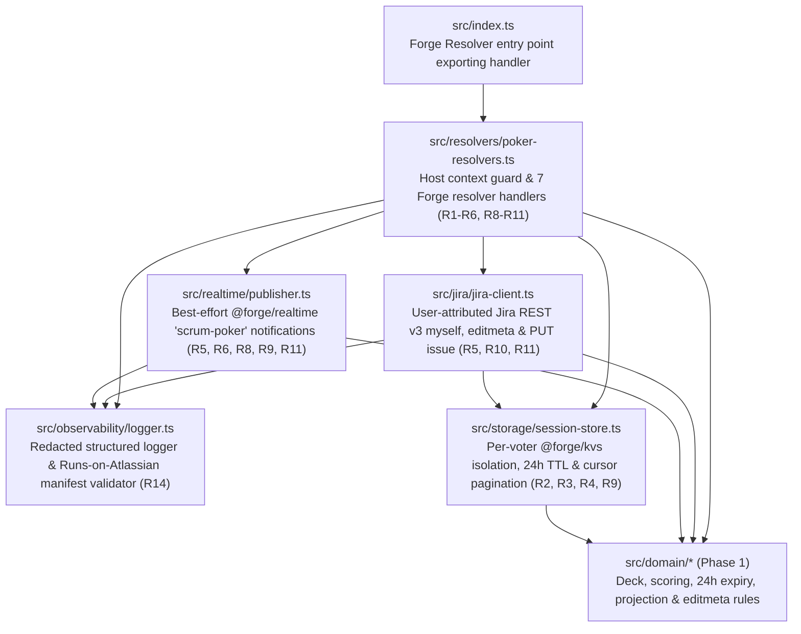

# Phase 2 Design: Forge Backend Resolvers, Per-Voter KVS Storage, Realtime Sync, and Jira Write-Back

## Overview & Minimal-Seam Rationale

Phase 2 implements the Atlassian Forge backend under `src/` (`nodejs22.x` runtime) on top of Phase 1's pure domain layer (`src/domain/`). To keep the backend deterministic, secure, and 100% verifiable in-process without live cloud containers, Phase 2 introduces five focused backend modules wired into `src/index.ts`:

1. **Thin Orchestration Over Pure Domain Rules:** All deck/score validation (`R1`), participant ordering and pre-reveal card redaction (`R5`), average/Fibonacci snapping, 24-hour expiry math (`R9`), and `editmeta` field detection (`R10`) delegate directly to Phase 1's `src/domain/` modules rather than duplicating logic in resolvers.
2. **Narrow Structural SDK Ports:** Storage (`KvsClientLike`), realtime publishing (`RealtimePublishFn`), Jira HTTP calls (`JiraRequester`), resolver registration (`ResolverRegistryLike`), clock evaluation (`now: () => number`), and structured logging (`LogSink`) accept optional structural dependencies that default to the production `@forge/kvs`, `@forge/realtime`, `@forge/api`, and `@forge/resolver` SDKs (`() => Date.now()`). Tests can inject deterministic in-memory harnesses directly or mock `@forge/*` modules seamlessly.
3. **Lock-Gate Safe Entry Point (`src/index.ts`):** `src/index.ts` exports `handler = resolver.getDefinitions()` without executing throwing stub calls at module load time, while every Phase 2 factory and helper stub throws `new Error('not implemented')` so imports succeed cleanly and every acceptance test fails red (`exit 1`) at `lintel lock`.

---

## Module Responsibilities & Dependency Graph

Backend modules form a strict directed acyclic graph (DAG) with zero circular imports and zero browser DOM globals (`window`, `document`, `navigator`):

1. **`src/observability/logger.ts` (`R14`)**
   - `sanitizeLogMetadata(metadata)` validates `metadata` with the strict plain-object prototype check (`Object.getPrototypeOf(metadata) === Object.prototype || Object.getPrototypeOf(metadata) === null`, matching `src/domain/jira-fields.ts`, so `Date`, `Error`, `Map`, `Set`, arrays, `null`, and primitives deterministically throw `PokerDomainError` with `code: 'validation-error'`), and deeply clones structured log context anchored at root `depth = 0` (recursively sanitizing nested plain objects and arrays at `depth = 1..4`, and replacing nested plain objects and arrays at `depth > 4` with `'[TRUNCATED]'`) while redacting sensitive keys (`card`, `cards`, `viewerCard`, `vote`, `votes`, `participants`, `authorization`, `cookie`, `set-cookie`, `token`, `accessToken`, `refreshToken`, `apiKey`, `secret`, `password`, `credential`, `credentials`, `email`, `emailAddress`, matched case-insensitively) and string values containing email addresses or `Bearer`/`Basic` credentials to `REDACTED_VALUE` (`'[REDACTED]'`).
   - `createBackendLogger(options)` emits structured JSON records (`{ level: 'WARN' | 'ERROR', event, timestamp, context }`) to `console.warn` / `console.error` (or an injected `LogSink`).
   - `validatePlatformManifest(manifestYaml)` verifies `manifest.yml` compliance in pure TypeScript: confirms `jira:issuePanel` (`title: Scrum Poker`), function handler `index.handler`, runtime `nodejs22.x`, zero `external:` permission blocks, zero `http://` or `https://` URLs, and exact scope equality with `REQUIRED_FORGE_SCOPES` (`['storage:app', 'read:jira-work', 'write:jira-work', 'read:jira-user']`).

2. **`src/storage/session-store.ts` (`R2`, `R3`, `R4`, `R9`)**
   - `assertSafeIdentifier(value, label)` enforces canonical trimmed non-empty strings (`length <= 128`, no `/`, `\`, or `\0` characters, permitting `:` for Atlassian `accountId`s such as `'712020:...'`), throwing `PokerDomainError` (`code: 'validation-error'`) on violation.
   - Isolates KVS keys strictly per issue and per voter:
     - Metadata key: `poker:${issueId}:meta` storing `RoundMeta` (`{ roundId, status, overrideScore, updatedAt }`).
     - Per-voter key: `poker:${issueId}:${roundId}:vote:${accountId}` storing `VoteRecord` (`{ accountId, displayName, avatarUrl, card, votedAt }`).
   - Every `set` passes `KVS_TTL_24H` (`{ ttl: { value: 24, unit: 'HOURS' } }`).
   - `nextRoundId(previousRoundId)` computes deterministic round progression (`null | undefined -> 'round-1'`, `'round-N' -> 'round-(N+1)'`, `'custom-N' -> 'custom-(N+1)'`, `'custom' -> 'custom-2'`) using `BigInt` arithmetic. Because concurrent initial votes on an idle or expired issue compute the exact same next `roundId`, simultaneous first votes write to disjoint voter keys under the same round and never orphan a peer's vote.
   - `listVoterRecords(issueId, roundId, nowMs)` loops `kvs.query().where('key', WhereConditions.beginsWith(prefix)).limit(100)` across every `nextCursor` page until exhausted (`>100` voters), validates stored records with runtime type guards, and filters out any record where `isRoundExpired(vote.votedAt, nowMs)` is `true` (dual 24-hour guard).
   - `deleteRoundVotes(issueId, roundId)` collects **all** matching keys across all `nextCursor` pages first and only then deletes every collected key, preventing mid-scan index shifting on offset-based cursor implementations.

3. **`src/realtime/publisher.ts` (`R5`, `R6`, `R8`, `R9`, `R11`, `R14`)**
   - Publishes strictly typed, card-free events to `POKER_REALTIME_CHANNEL` (`'scrum-poker'`):
     - `{ type: 'SESSION_UPDATED', roundId, updatedAt }` after vote cast/update/withdrawal, reveal, override, or reset.
     - `{ type: 'points-applied', roundId, score, updatedAt }` after Story Points are written to Jira.
   - Treats `@forge/realtime` delivery as best-effort after durable KVS/Jira state commits: if `publish` rejects transiently, `createRealtimePublisher` logs a redacted `WARN` entry via `BackendLogger` and resolves cleanly without aborting the caller's completed mutation.

4. **`src/jira/jira-client.ts` (`R5`, `R10`, `R11`, `R14`)**
   - Executes all Jira Cloud REST API v3 requests via `api.asUser().requestJira(route\`...\`)` so Jira enforces the acting user's permissions and records user attribution in issue history:
     - `getCurrentUserProfile()` calls `GET /rest/api/3/myself`, normalizes `displayName` via `normalizeDisplayName` (`'Unknown User'` fallback), extracts `avatarUrl` (preferring top-level `avatarUrl`, then `avatarUrls['24x24']`, `'32x32'`, `'48x48'`, `'16x16'`), discards `emailAddress` and other PII, and degrades gracefully to `{ displayName: 'Unknown User', avatarUrl: null }` on non-OK HTTP statuses, invalid JSON, or transport failures.
     - `getEditableStoryPointsField(issueId)` calls `GET /rest/api/3/issue/${issueId}/editmeta`, delegates to `detectStoryPointsField`, and returns `null` without throwing on `401`/`403` (expected for read-only observers), `404`/`5xx`, malformed JSON, or transport errors.
     - `updateStoryPoints(issueId, score)` inspects `GET /rest/api/3/issue/${issueId}/editmeta` as the acting user: maps `401`/`403` to `'forbidden'`, other non-OK statuses or transport/JSON errors to `'jira-error'`, and `null` field detection on `200 OK` to `'missing-field'` (issuing zero `PUT` requests). When a qualifying field is found, executes `PUT /rest/api/3/issue/${issueId}` with `{ fields: { [fieldId]: score } }`, mapping `401`/`403` to `'forbidden'`, `400`/`404`/`5xx` or transport errors to `'jira-error'`, and `2xx` to `{ ok: true, appliedScore: score, fieldId, fieldName }`.

5. **`src/resolvers/poker-resolvers.ts` & `src/index.ts` (`R1`–`R6`, `R8`–`R11`)**
   - `extractAuthenticatedContext(context)` derives `issueId` (`context.extension.issue.id`) and `accountId` (`context.accountId`) exclusively from the host platform context, ignoring any client-supplied `issueId`, `issueKey`, or `accountId` in `payload`, and rejecting missing or malformed identifiers with `PokerDomainError` (`code: 'validation-error'`) before any KVS or Jira call.
   - Orchestrates the 7 RPC resolvers (`getSession`, `castVote`, `withdrawVote`, `revealVotes`, `selectOverrideScore`, `resetRound`, `applyStoryPoints`), wired onto a `Resolver` instance in `src/index.ts` and exported as `handler`.

---

## Control Flow & State Transitions

- **Cross-Handler `storyPointsField` Resolution & Zero-Jira-Call Guard Rule (`R10`, `R11`, `R13`):**
  - Every one of the 6 `SessionSnapshot`-returning handlers (`getSession`, `castVote`, `withdrawVote`, `revealVotes`, `selectOverrideScore`, and `resetRound`) resolves `storyPointsField` via `jira.getEditableStoryPointsField(issueId)` **exactly once per non-throwing invocation**, and **only after** all host-context, payload (`validation-error`), round-state (`invalid-state`), and precondition (`precondition-failed`) guards have passed.
  - Whenever any handler rejects with `PokerDomainError` (`validation-error`, `invalid-state`, or `precondition-failed`), it performs **zero** Jira requests (`0` calls to `getEditableStoryPointsField`, `getCurrentUserProfile`, or `updateStoryPoints`).
  - Resolving `storyPointsField` across all 6 snapshot-returning handlers ensures voting, withdrawal, reveal, consensus override, and reset never clobber Story Points field detection to `null` right when post-reveal UI controls need it.

1. **Read Path (`getSession` — `R2`, `R4`, `R5`, `R9`, `R10`):**
   - Validates host context (`validation-error` -> zero KVS or Jira calls) -> reads `RoundMeta` and `storyPointsField` (`jira.getEditableStoryPointsField(issueId)`) concurrently -> if `meta === null` or `isRoundExpired(meta.updatedAt, nowMs)`, returns `createIdleSessionSnapshot(storyPointsField, null)` **without** writing to KVS (never extending an expired round's `updatedAt`) -> otherwise paginates all active votes and projects via `projectSessionSnapshot` (redacting peer `card` values while `'voting'`).

2. **Voting & Withdrawal (`castVote`, `withdrawVote` — `R1`, `R3`, `R4`, `R5`, `R9`, `R10`):**
   - Validates host context and (for `castVote`) `validateDeckCard(payload.card)` before any KVS or Jira I/O.
   - Rejects with `PokerDomainError('invalid-state')` (making zero Jira calls) when `meta` is an active `'revealed'` round.
   - In both `castVote` and `withdrawVote`, a voter record returned by `getVoterRecord(issueId, meta.roundId, accountId)` counts as **active** only when `vote !== null && !isRoundExpired(vote.votedAt, nowMs)`.
   - When `meta` is `null` or expired during `castVote`: advances to `roundId = nextRoundId(meta?.roundId)`, sweeps any prior-round vote keys (`deleteRoundVotes`), resolves voter profile (`jira.getCurrentUserProfile()`) and `storyPointsField` (`jira.getEditableStoryPointsField(issueId)`), writes caller's vote key and `meta` (`status: 'voting'`), publishes `'SESSION_UPDATED'`, and returns the projected snapshot.
   - When `meta` is an active `'voting'` round during `castVote`: reads caller's existing vote key. If an active vote (`!isRoundExpired(vote.votedAt, nowMs)`) already matches `card`, toggles off by deleting caller's vote key, refreshing `meta.updatedAt = nowMs`, publishing `'SESSION_UPDATED'`, resolving `storyPointsField` (`jira.getEditableStoryPointsField(issueId)`), and returning the updated snapshot (`viewerCard: null`); otherwise (including when a stored vote record is expired) fetches voter profile (`jira.getCurrentUserProfile()`) and `storyPointsField` (`jira.getEditableStoryPointsField(issueId)`), writes caller's vote key (`votedAt: nowMs`), refreshes `meta.updatedAt = nowMs`, publishes `'SESSION_UPDATED'`, and returns the updated snapshot (`viewerCard: card`).
   - During `withdrawVote`: resolves `storyPointsField` (`jira.getEditableStoryPointsField(issueId)`) and returns `createIdleSessionSnapshot(storyPointsField, null)` idempotently when `meta` is `null` or expired (zero KVS writes); resolves `storyPointsField` and returns the current `'voting'` snapshot idempotently without mutating `meta` or peers' votes when caller has no active vote (`vote === null || isRoundExpired(vote.votedAt, nowMs)`); otherwise deletes caller's vote key, refreshes `meta.updatedAt = nowMs`, publishes `'SESSION_UPDATED'`, resolves `storyPointsField`, and returns the updated snapshot (`viewerCard: null`).

3. **Reveal, Override & Reset (`revealVotes`, `selectOverrideScore`, `resetRound` — `R6`, `R8`, `R9`, `R10`):**
   - `revealVotes`: fails with `PokerDomainError('precondition-failed')` (making zero Jira calls) when `meta` is `null`, expired, or (`meta.status === 'voting'` and `listVoterRecords` returns `0` active votes); once guards pass, resolves `storyPointsField = await jira.getEditableStoryPointsField(issueId)` and either returns the current revealed snapshot idempotently (preserving `meta.overrideScore` and votes with zero KVS writes) when already actively `'revealed'`, or writes `meta = { roundId, status: 'revealed', overrideScore: null, updatedAt: nowMs }`, publishes `'SESSION_UPDATED'`, and returns the revealed snapshot (`targetScore = recommendedScore`, `storyPointsField`).
   - `selectOverrideScore`: validates `validateFibonacciScore(payload.score)` (`validation-error` on `'?'`, negatives, `-0`, decimals, non-Fibonacci numbers); rejects `'voting'`, idle, or expired rounds with `PokerDomainError('invalid-state')` (making zero Jira calls); updates `meta.overrideScore = score` and `updatedAt = nowMs`, publishes `'SESSION_UPDATED'`, resolves `storyPointsField = await jira.getEditableStoryPointsField(issueId)`, and returns the updated snapshot (`targetScore === score`, `storyPointsField`).
   - `resetRound`: after host-context validation passes, computes `newRoundId = nextRoundId(meta?.roundId)`, writes fresh `meta = { roundId: newRoundId, status: 'voting', overrideScore: null, updatedAt: nowMs }` **before** sweeping prior-round vote keys so concurrent readers immediately observe the empty round, publishes `'SESSION_UPDATED'`, resolves `storyPointsField = await jira.getEditableStoryPointsField(issueId)`, and returns `createIdleSessionSnapshot(storyPointsField, newRoundId)`.

4. **Story Points Write-Back (`applyStoryPoints` — `R1`, `R9`, `R10`, `R11`):**
   - Validates host context and `validateFibonacciScore(payload.score)` (`0` through `21`), then verifies an active `'revealed'` round (`invalid-state` if `'voting'`, idle, or expired—before any Jira call).
   - Calls `jira.updateStoryPoints(issueId, score)` (without a separate `getEditableStoryPointsField` call). On `'missing-field'`, `'forbidden'`, or `'jira-error'`, leaves KVS `meta` (`overrideScore`, `status: 'revealed'`) and all votes completely intact and returns `{ ok: false, reason, score, message }`.
   - On `ok: true`, advances `meta` to a fresh idle `'voting'` round (`newRoundId = nextRoundId(meta.roundId)`), deletes prior round vote keys, publishes `{ type: 'points-applied', roundId: newRoundId, score, updatedAt: nowMs }`, and returns `{ ok: true, appliedScore: score, fieldName, session }` where `session` is `createIdleSessionSnapshot({ fieldId, fieldName }, newRoundId)`.

---

## Security, Trust Boundaries & Operability

- **Explicit Trust Boundaries:**
  1. **Custom UI Iframe -> Forge Resolver (`src/resolvers/poker-resolvers.ts`):** `req.payload` is untrusted user input; `issueId` and `accountId` are read exclusively from Forge's authenticated `req.context`, and card/score inputs are validated against strict allowlists before any I/O.
  2. **Forge Runtime -> Forge KVS (`src/storage/session-store.ts`):** KVS keys are constructed strictly from validated identifiers (`assertSafeIdentifier`, blocking `/`, `\`, `\0`, whitespace, and `>128`-char inputs), and stored JSON records are validated via runtime type guards on read.
  3. **Forge Runtime -> Jira REST v3 (`src/jira/jira-client.ts`):** Paths are constructed exclusively with `@forge/api` `route\`...\`` template tags (preventing path traversal/SSRF) under `api.asUser()`, responses check `response.ok`, `emailAddress` is never retained from `/rest/api/3/myself`, and updates modify solely `[detectedField.fieldId]`.
  4. **Forge Runtime -> Forge Realtime & Logs (`src/realtime/publisher.ts`, `src/observability/logger.ts`):** Realtime events carry only `{ type, roundId, updatedAt, score? }`, and `BackendLogger` scrubs cards, votes, credentials, and emails before serialization.
- **Operability & Resilience:** All external calls operate within Forge's bounded invocation budget with graceful fallbacks for non-critical dependencies (`/rest/api/3/myself`, read-path `editmeta`, and `@forge/realtime` `publish`) and atomic state preservation whenever `applyStoryPoints` fails.

---

## Test outline

- R1 unit: verifies castVote accepts all 9 canonical deck cards ('0', '1', '2', '3', '5', '8', '13', '21', '?') and rejects empty strings, whitespace-padded strings (' 5', '5 '), negative strings ('-1'), decimals ('3.5'), non-Fibonacci integers ('4', '6', '34'), arbitrary words ('coffee'), null, undefined, and missing or non-object payloads with PokerDomainError code 'validation-error' before performing any KVS or Jira calls
- R1 unit: verifies selectOverrideScore and applyStoryPoints accept all 8 numeric Fibonacci scores (0, 1, 2, 3, 5, 8, 13, 21) and reject -0, -1, 4, 4.5, 22, NaN, Infinity, '?', numeric strings, null, undefined, and missing payloads with PokerDomainError code 'validation-error' leaving prior session state intact and making zero Jira calls
- R2 unit: verifies all 7 resolver handlers scope KVS keys and Jira calls strictly to context.extension.issue.id and context.accountId (including colon-delimited Atlassian account IDs), ignore spoofed issueId or accountId fields in payload across distinct issues (Issue A vs Issue B), return an idle 'voting' snapshot with 0 participants and null card/score fields on uninitialized issues, and reject missing, blank, whitespace-padded, overlong, or path-separator host context identifiers with PokerDomainError code 'validation-error' and zero KVS or Jira I/O
- R3 unit: verifies castVote and withdrawVote in 'voting' state record an initial vote (1 participant, viewerCard set, 24h KVS TTL), update an existing vote ('5' -> '8' keeping 1 participant), remove the caller's vote both via withdrawVote and by re-selecting the caller's current active card in castVote (0 participants, viewerCard null), treat a stored voter record as active only when !isRoundExpired(vote.votedAt, nowMs) (overwriting an expired same-card record in castVote rather than toggling off, and treating an expired or absent voter record in withdrawVote idempotently without mutating meta or peers' votes), and reject castVote and withdrawVote during an active 'revealed' round with PokerDomainError code 'invalid-state' and zero Jira calls
- R4 unit: verifies concurrent Promise.all votes across 5 distinct participants (both on an active 'voting' round and simultaneously initializing an idle or expired round via deterministic nextRoundId) and concurrent peer update + withdrawal + new vote persist with zero lost updates, and verifies KVS cursor pagination across >100 voters (e.g. 125 participants across multiple nextCursor pages) returns 100% of active voters on getSession/revealVotes and deletes 100% of prior-round keys on resetRound/applyStoryPoints without mid-scan cursor truncation
- R5 unit: verifies resolver snapshots include only active voters ordered by ascending votedAt then ascending lexicographical accountId, normalize blank/whitespace or failed /rest/api/3/myself profiles to 'Unknown User', redact all participants[i].card values to null during 'voting' while exposing viewerCard solely to the requesting voter, and omit all card values and PII from @forge/realtime 'scrum-poker' payloads
- R6 unit: verifies revealVotes allows any authenticated viewer (including non-voting observers) to transition a 'voting' round with >= 1 vote to 'revealed' (exposing cards, computing scores, setting targetScore to recommendedScore, refreshing updatedAt, and publishing SESSION_UPDATED), rejects revealVotes on 0-vote, idle, or reset rounds with PokerDomainError code 'precondition-failed' and zero Jira calls, and handles concurrent/repeat revealVotes on an active 'revealed' round idempotently while preserving any existing targetScore override
- R8 unit: verifies selectOverrideScore allows any viewer on an active 'revealed' round to set shared targetScore to 0..21 (including on all-'?' rounds where average and recommendedScore remain null) while preserving recorded votes and publishing SESSION_UPDATED, and rejects selectOverrideScore on 'voting', idle, or expired rounds with PokerDomainError code 'invalid-state' and zero Jira calls
- R9 unit: verifies resetRound advances to a distinct roundId in 'voting' state with 0 participants, deletes prior-round votes, and publishes SESSION_UPDATED; verifies rounds remain active at elapsed 86_399_999 ms and negative clock skew (nowMs < updatedAt) and expire at >= 86_400_000 ms (getSession returns idle 'voting' without extending updatedAt, castVote starts a fresh round discarding stale votes, revealVotes rejects with 'precondition-failed', selectOverrideScore and applyStoryPoints reject with 'invalid-state', and listVoterRecords/castVote/withdrawVote treat individual votedAt records with elapsed >= 86_400_000 ms as expired)
- R10 unit: verifies getEditableStoryPointsField inspects GET /rest/api/3/issue/{issueId}/editmeta via api.asUser(), applies 'Story Points' over 'Story point estimate' precedence and lexicographical fieldId tie-breaking for numeric 'set'-capable fields, verifies all 6 SessionSnapshot-returning handlers (getSession, castVote, withdrawVote, revealVotes, selectOverrideScore, resetRound) populate snapshot.storyPointsField via jira.getEditableStoryPointsField(issueId) once guards pass (making zero Jira requests when context, payload, invalid-state, or precondition-failed guards reject), and returns null cleanly without failing session operations when editmeta returns 401/403, 404/500, malformed JSON, transport errors, or non-matching fields
- R11 unit: verifies applyStoryPoints rejects 'voting' or expired rounds with PokerDomainError code 'invalid-state' before calling Jira, updates the detected field via PUT /rest/api/3/issue/{issueId} as the acting user (including score 0), clears the round, publishes 'points-applied' with the score, and returns { ok: true, appliedScore, fieldName, session } on 2xx, while leaving the 'revealed' round, votes, and targetScore intact on missing editable field ({ ok: false, reason: 'missing-field', score }), 401/403 ({ ok: false, reason: 'forbidden', score }), or 400/404/5xx/transport failure ({ ok: false, reason: 'jira-error', score }), and degrades gracefully if realtime publish rejects after commit
- R14 unit: verifies validatePlatformManifest confirms manifest.yml declares jira:issuePanel ('Scrum Poker', handler 'index.handler', runtime 'nodejs22.x'), zero external permissions or http/https URLs, and only the 4 required scopes (rejecting extra/missing scopes or external URLs), and verifies sanitizeLogMetadata (including strict plain-object prototype rejection of top-level Date/Error/Map/Set/Array/null with 'validation-error', and depth-0 root / depth-1..4 recursive sanitization / depth > 4 '[TRUNCATED]' replacement), createBackendLogger, and Jira/realtime error paths strip unrevealed card values, credentials/tokens, and email addresses from logs and /rest/api/3/myself responses
- integration: none: Forge KVS, Realtime, and Jira REST boundaries are verified in-process via deterministic SDK doubles in the unit suite
- e2e: none: Custom UI workflows and Forge bridge interactions are verified under jsdom and Testing Library in the unit suite
