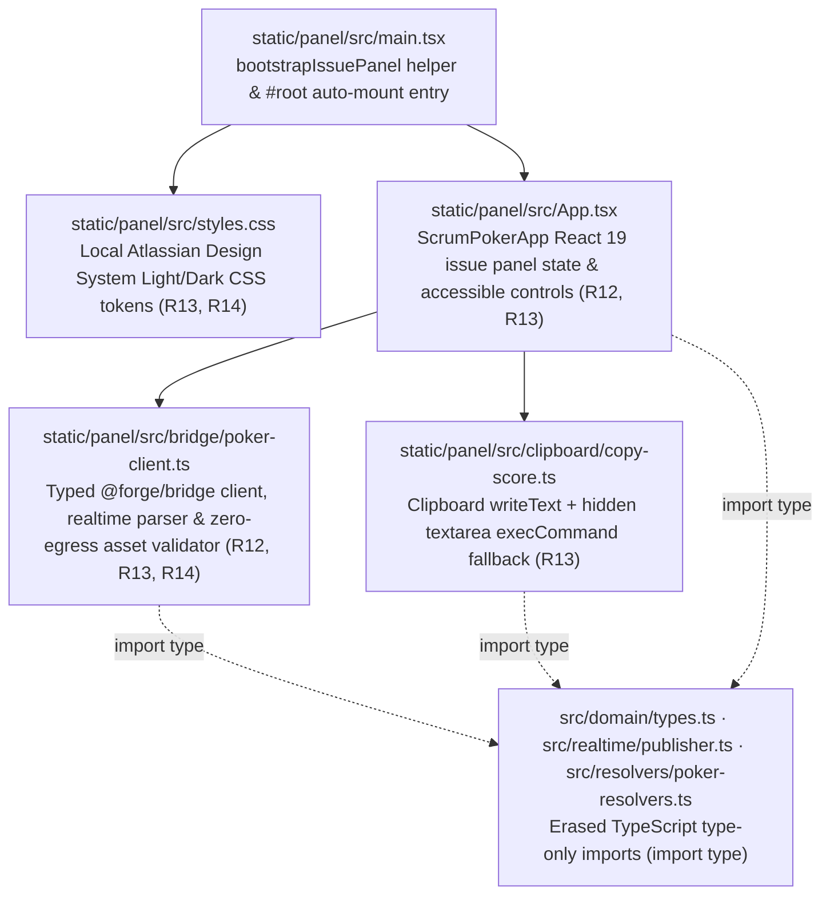

# Phase 3 Design: Custom UI Jira Issue Panel, Live Synchronization, Score Override, and Clipboard Fallback

## Overview & Minimal-Seam Rationale

Phase 3 delivers the React 19 Custom UI Jira issue panel under `static/panel/src/`, completing **Scrum Poker for Jira** (`R12`, `R13`, `R14`) on top of Phase 1's domain rules (`src/domain/`) and Phase 2's Forge resolvers (`src/resolvers/poker-resolvers.ts`).

To keep the frontend compact, strictly isolated from backend Node.js SDKs, and 100% deterministic under Vitest + `jsdom` + React Testing Library without live Forge iframes, Phase 3 introduces four focused TypeScript/React modules and one local stylesheet:

1. **Strict Runtime Isolation (`conventions.md`, `atlassian-forge`, `R14`):** Frontend modules under `static/panel/src/` import runtime values exclusively from `react`, `react-dom/client`, `@forge/bridge`, and sibling `static/panel/src/` files. Shared RPC and domain contracts from `src/` are imported strictly via erased `import type` declarations so zero backend modules (`@forge/kvs`, `@forge/api`, `@forge/realtime`, `@forge/resolver`) can ever enter the Vite browser bundle.
2. **Narrow Injectable Ports (`node-design`):**
   - `createPokerClient(deps)` wraps `@forge/bridge` (`invoke`, `realtime.subscribe`, `view.theme.enable`, `view.refresh`) behind a narrow `PokerClient` interface so UI suites can either inject an in-memory `PokerClient` prop directly or mock `@forge/bridge` at module level.
   - `copyScoreToClipboard(score, env)` accepts an optional `CopyScoreEnv` (`clipboard`, `document`) defaulting to browser globals, attempting `navigator.clipboard.writeText` first and falling back to an off-screen `<textarea>` + `document.execCommand('copy')` (with deterministic `finally` DOM cleanup) before returning a structured fallback result.
3. **Lock-Gate Red-Phase Compatibility (`test-design`):** `static/panel/src/main.tsx` only auto-mounts when `#root` exists in `document` (absent in fresh `jsdom` module loads), while `bootstrapIssuePanel`, `ScrumPokerApp`, `createPokerClient`, `parseRealtimeEvent`, `validateUiAssetCompliance`, `formatScoreForClipboard`, and `copyScoreToClipboard` stubs throw/reject `new Error('not implemented')`. Every Phase 3 acceptance test imports cleanly, passes `./.lintel/scripts/build.sh` (`biome`, `tsc --noEmit`, `vite build`), and fails red (`exit 1`) at `lintel lock`.

---

## Module Responsibilities & Dependency Graph

Frontend modules form a strict directed acyclic graph (DAG) with zero circular imports and zero external asset URLs:

1. **`static/panel/src/bridge/poker-client.ts` (`R12`, `R13`, `R14`)**
   - Defines canonical frontend deck constants (`PANEL_DECK_CARDS`, `PANEL_NUMERIC_SCORES`), channel constant (`PANEL_REALTIME_CHANNEL = 'scrum-poker'`), and resolver keys (`PANEL_RESOLVER_KEYS`).
   - `parseRealtimeEvent(rawPayload)` parses object or single-encoded JSON-string payloads from `@forge/bridge` `realtime.subscribe` into a validated `PokerRealtimeEvent` (`'SESSION_UPDATED'` or `'points-applied'`), rejecting malformed payloads, double-encoded strings, invalid identifiers/scores, and any payload carrying unrevealed vote/card properties by returning `null` without throwing.
   - `createPokerClient(deps)` provides typed RPC methods (`getSession`, `castVote`, `withdrawVote`, `revealVotes`, `selectOverrideScore`, `resetRound`, `applyStoryPoints`), host view helpers (`enableTheme`, `refreshIssueView`), and `subscribeToSessionEvents(onEvent)` returning an idempotent `() => Promise<void>` cleanup function that synchronously silences events on teardown and awaits `subscription.unsubscribe()` even when unmounted before `realtime.subscribe` resolves.
   - `validateUiAssetCompliance(assetSource, assetLabel)` inspects HTML, SVG, CSS, and TypeScript/JSX asset source strings to verify `Runs on Atlassian` zero-egress compliance: permits standard W3C XML namespace identifiers (`http://www.w3.org/2000/svg`, etc.) while flagging any `http://` / `https://` URL, protocol-relative external asset reference (`//...`), direct browser network API (`fetch`, `XMLHttpRequest`, `WebSocket`, `EventSource`, `navigator.sendBeacon`), or backend-only Forge SDK import (`@forge/kvs`, `@forge/api`, `@forge/realtime`, `@forge/resolver`).

2. **`static/panel/src/clipboard/copy-score.ts` (`R13`)**
   - `formatScoreForClipboard(score)` validates `score` against `[0, 1, 2, 3, 5, 8, 13, 21]` (rejecting `-0`, negatives, decimals, `NaN`, `Infinity`, and non-Fibonacci values with `RangeError`) and returns its exact decimal text (`"0"` through `"21"`).
   - `copyScoreToClipboard(score, env)` attempts `clipboard.writeText(text)` (`method: 'clipboard-api'`), falls back to an off-screen read-only `<textarea>` + `document.execCommand('copy')` (`method: 'exec-command'`) with guaranteed `finally` node removal when `writeText` is missing or blocked by iframe permissions, and returns `{ ok: false, text, message }` containing the decimal score if both mechanisms fail.

3. **`static/panel/src/styles.css` (`R13`, `R14`)**
   - Defines compact, responsive Jira issue-panel styles driven by Atlassian Design System CSS custom properties (`--ds-surface`, `--ds-surface-raised`, `--ds-text`, `--ds-text-subtle`, `--ds-text-inverse`, `--ds-border`, `--ds-border-focused`, `--ds-background-neutral`, `--ds-background-selected`, `--ds-text-selected`, `--ds-background-brand-bold`, `--ds-background-warning`, `--ds-text-warning`, `--ds-background-danger`, `--ds-text-danger`, `--ds-background-success`, `--ds-text-success`) with accessible Light and Dark (`@media (prefers-color-scheme: dark)` and `[data-color-mode="dark"]`) fallback variables, `:focus-visible` keyboard outlines, and zero external fonts, images, or URLs.

4. **`static/panel/src/App.tsx` (`R12`, `R13`, `R14`)**
   - Renders `ScrumPokerApp`, orchestrating initial theme activation (`enableTheme`), session loading (`getSession`), live realtime synchronization (`subscribeToSessionEvents`), interactive card voting and withdrawal, democratic reveal and reset transitions, post-reveal score override, Story Points write-back with `refreshIssueView()` and confirmation banner, and missing-field inline warning + clipboard fallback.

5. **`static/panel/src/main.tsx` (`R13`, `R14`)**
   - Imports `./styles.css`, exports `bootstrapIssuePanel(container, props)` (creating a React 19 root without `StrictMode` double-effect invocation so mount side effects run once deterministically), and auto-mounts into `#root` when present in `document`.

---

## Control Flow, Concurrency & Edge Cases

1. **Initialization & Unmount Lifecycle (`R12`, `R13`):**
   - On mount, `ScrumPokerApp` concurrently calls `pokerClient.enableTheme()` (swallowing host-theme errors gracefully), registers `pokerClient.subscribeToSessionEvents(...)` on `'scrum-poker'`, and invokes `pokerClient.getSession()`.
   - While initial `getSession()` is pending, the panel renders `Loading Scrum Poker…` (`role="status"`). If initial load rejects, it renders an `alert` error banner and a **Retry** button (`retry-load-button`).
   - On unmount, `ScrumPokerApp` marks the instance disposed (preventing any late `getSession()` or action promise from mutating unmounted state or firing `refreshIssueView()`) and invokes the subscription cleanup function so `unsubscribe()` is guaranteed to run both after resolved subscriptions and for subscriptions still settling at unmount time.

2. **Epoch-Guarded State Synchronization & Deduplicated Issue Refresh (`R12`):**
   - A monotonic `mutationEpoch` counter protects direct user actions (`castVote`, `withdrawVote`, `revealVotes`, `selectOverrideScore`, `resetRound`, `applyStoryPoints`) against stale background `getSession()` responses that started before a user mutation completed.
   - On `SESSION_UPDATED`: the panel fetches `pokerClient.getSession()` in the background (zero polling intervals, zero page reloads) and updates `session` if no newer fetch or user mutation has superseded it.
   - On Story Points save (`applyStoryPoints` returning `ok: true` locally **or** `'points-applied'` arriving over `realtime`):
     - A bounded set `handledPointsAppliedRoundIds` (max `64` entries, evicting oldest FIFO) deduplicates `roundId` between the acting viewer's direct `applyStoryPoints` response and any echoed `'points-applied'` event on the same tab:
       - **Acting viewer:** updates `session` to `result.session`, sets `appliedConfirmationScore = result.appliedScore` (`Story Points set to <score>`), records `result.session.roundId`, and calls `pokerClient.refreshIssueView()` once. If a self-echo `'points-applied'` with the same `roundId` arrives before or after, `refreshIssueView()` is not duplicated and the confirmation banner remains visible.
       - **Peer viewers:** on `'points-applied'` for an unhandled `roundId`, records `event.roundId`, sets `appliedConfirmationScore = event.score`, fetches `pokerClient.getSession()` to transition to the cleared idle state, and calls `pokerClient.refreshIssueView()` once.
     - The `Story Points set to <score>` confirmation banner stays visible while the round remains an empty `'voting'` round (`0` participants) and clears automatically once a new vote is cast or a new action begins.

3. **Voting, Reveal, Consensus Override & Missing-Field Fallback (`R13`):**
   - **Deck buttons (`0, 1, 2, 3, 5, 8, 13, 21, ?`):**
     - During `'voting'`: `aria-pressed` is `"true"` only for `session.viewerCard === card` (`"false"` for all other cards); clicking the pressed card invokes `withdrawVote()`, while clicking any unpressed card invokes `castVote(card)`.
     - During `'revealed'`: `'?'` has `disabled={true}` and `aria-pressed="false"`; numeric cards `'0'..'21'` are enabled with `aria-pressed="true"` iff `session.targetScore !== null && String(session.targetScore) === card` (preserving `0` accurately via strict non-null comparison), and clicking any numeric card invokes `selectOverrideScore(Number(card))`.
   - **Participant chips (defense-in-depth secrecy):**
     - `0` voters in `'voting'`: renders `Pick a card to start voting`, with **Show Votes** and **Reset** disabled.
     - `>= 1` voters in `'voting'`: renders each voter strictly as `<Display Name> ✓` (never rendering `participant.card` or external `` elements) and enables **Show Votes** and **Reset**.
     - `'revealed'`: renders each voter as `<Display Name>: <card>` alongside `Average: <formattedAverage>` and `Recommended: <recommendedScore>` (or `No numeric votes` when `recommendedScore === null`, plus an override guidance prompt when `targetScore === null`).
   - **Write-back vs Copy Score:**
     - When `session.storyPointsField !== null && session.targetScore !== null`: renders **Set Story Points → `<targetScore>`** alongside **Re-vote**.
     - If `applyStoryPoints` returns `{ ok: false, reason: 'missing-field' }`, `ScrumPokerApp` updates `session` in place with `storyPointsField: null` while preserving all revealed votes and `targetScore`, immediately surfacing the inline missing-field warning (`No editable Story Points field is available on this issue screen.`) and switching the primary button to **Copy Score (`<targetScore>`)**.
     - If `applyStoryPoints` returns `'forbidden'` or `'jira-error'`, `ScrumPokerApp` keeps the `'revealed'` round, votes, and `targetScore` intact and renders `result.message` inside the `alert` error banner.
     - Clicking **Copy Score (`<targetScore>`)** invokes `copyScoreToClipboard(targetScore)`: on `{ ok: true }` renders `Copied!` (`role="status"`) while keeping revealed votes visible; on `{ ok: false }` renders the inline fallback message containing the numeric score (`role="alert"`). Changing `targetScore` or resetting the round clears prior copy feedback.

---

## Security, Trust Boundaries & Operability

- **Zero External Egress (`R14`):** All UI markup (`static/panel/index.html`), icons (`static/assets/icon.svg`), styles (`static/panel/src/styles.css`), and scripts (`static/panel/src/**`) load locally inside Jira's Custom UI iframe with zero external URLs, zero external `` avatar fetches, zero telemetry/ads, and zero direct `fetch`/`WebSocket` calls.
- **Boundary Validation & Safe Rendering:** Realtime channel payloads are treated as untrusted boundary inputs validated by `parseRealtimeEvent` before triggering bridge reads; React JSX auto-escapes all `displayName` and Jira error strings (preventing XSS), and the UI never logs vote selections or user metadata to `console`.
- **Bounded Resources & Deterministic Cleanup:** Realtime subscriptions and temporary fallback `<textarea>` elements are deterministically cleaned up on unmount / `finally`, in-flight action locking prevents duplicate concurrent submissions from rapid clicks, and `handledPointsAppliedRoundIds` is bounded to `64` entries.

---

## Test outline

- R12 unit: verifies ScrumPokerApp and createPokerClient subscribe to the 'scrum-poker' realtime channel on mount, parse both object and JSON-string SESSION_UPDATED and points-applied events (ignoring malformed, double-encoded, error, or card-bearing payloads), automatically re-fetch getSession and re-render peer vote, withdrawal, reveal, targetScore override (including 0), and reset updates without polling or page reload, ignore stale out-of-order background getSession responses superseded by newer mutations, transition both acting and peer panels to the cleared idle state while invoking view.refresh once per panel (deduplicating echoed points-applied events by roundId across up to 64 rounds), and deterministically call unsubscribe on unmount (both after subscribe resolves and when unmounted before subscribe settles) while suppressing post-unmount events
- R13 unit: verifies ScrumPokerApp calls view.theme.enable on initialization, defines local Light/Dark Atlassian Design System CSS tokens in styles.css, renders all 9 deck cards ('0', '1', '2', '3', '5', '8', '13', '21', '?') in canonical order with accurate aria-pressed states, casts or updates votes on unpressed cards and calls withdrawVote when clicking viewerCard during 'voting', renders 'Pick a card to start voting' with Show Votes and Reset disabled at 0 voters, and renders '<Display Name> ✓' chips (never leaking cards) with Show Votes and Reset enabled at >= 1 voters
- R13 unit: verifies revealed-state controls, consensus override, Story Points write-back, and clipboard fallback including '<Display Name>: <card>' chips, formatted Average and Recommended display, 'No numeric votes' and numeric-card override prompt when all votes are '?' (with neither Set Story Points nor Copy Score rendered until an override card 0..21 is selected), '?' card disabled and active targetScore card (0..21) marked aria-pressed='true', primary 'Set Story Points → <targetScore>' saving score (0..21) and showing 'Story Points set to <score>' on the cleared idle panel, preserving revealed votes and showing an alert banner on 'forbidden'/'jira-error' or RPC rejection (plus initial-load Retry recovery), and displaying the missing-field warning plus 'Copy Score (<targetScore>)' whenever storyPointsField is null or applyStoryPoints returns 'missing-field' (covering navigator.clipboard.writeText success with 'Copied!', hidden textarea execCommand('copy') fallback with DOM cleanup, and inline manual-copy fallback message containing the numeric score when clipboard access fails)
- R14 unit: verifies validateUiAssetCompliance and static inspection across manifest.yml, static/panel/index.html, static/assets/icon.svg, static/panel/src/styles.css, and all static/panel/src TypeScript/TSX modules confirm zero external HTTP/HTTPS asset or API URLs (while permitting standard W3C SVG/XML namespace URIs), zero protocol-relative external URLs, zero direct fetch/XMLHttpRequest/WebSocket/EventSource/sendBeacon calls, zero backend-only @forge/kvs, @forge/api, @forge/realtime, or @forge/resolver imports in frontend code, and zero external avatar image requests or console vote logging during voting
- integration: none: Forge KVS, Realtime, and Jira REST boundaries are verified in-process via deterministic SDK doubles in the unit suite
- e2e: none: Custom UI workflows and Forge bridge interactions are verified under jsdom and Testing Library in the unit suite
